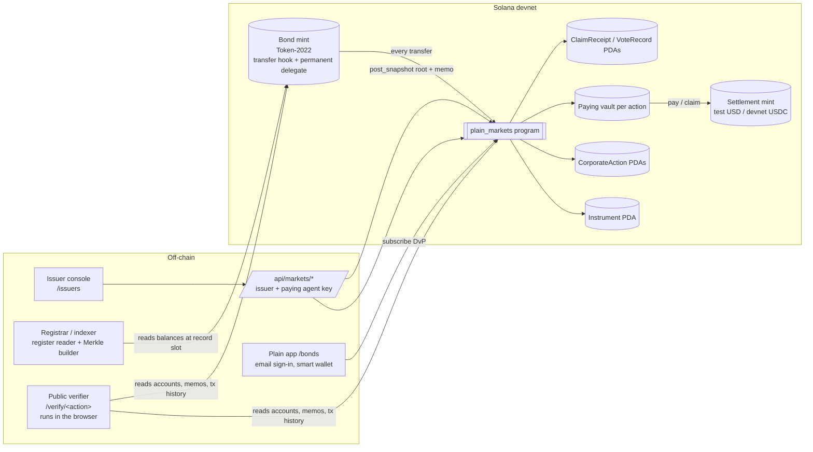

# Plain Markets: corporate actions for tokenized bonds on Solana

Technical overview for the Superteam Kazakhstan × KASE side track. Devnet only. The settlement
token is a test USD (the fiat leg is simulated). Not affiliated with or endorsed by KASE.

## One-page summary

**What it is.** `plain_markets` is an Anchor program on Solana devnet that services a tokenized bond
after issuance. It fixes who is entitled on the record date, takes the issuer's funding, pays every
holder exactly what the terms say, redeems and burns the bond at maturity, and runs bondholder
votes. The chain enforces each rule; no server is trusted to apply them. Around the program:

- an **issuer console** (`/issuers`) to announce and run each action,
- a **public verifier** (`/verify/<action>`) that re-derives each action in the browser from ledger
  data alone,
- an **investor view** in the Plain app (`/bonds`) with a real one-tap primary purchase (DvP in
  devnet USDC).

**The track's example ran live, end to end.** It is a bond with face 1,000, 10% a year, paid
semi-annually over 2 years. A holder of 10 bonds received **500 per coupon** and **10,000 + 500 at
maturity**. The run covered coupon payments, a vote, a partial early redemption and the final
redemption with burn. The instrument ended `Redeemed` with a supply of 0. All 65 transactions are
linked [below](#showcase-lifecycle-every-transaction). Each of the 6 actions opens in the verifier
with every check green.

**The calendar is accelerated for the demonstration.** One nominal year lasts 20 minutes, so the
2-year bond matures 40 minutes after issue. This is the only thing that differs from a real bond.
The program stores real issue and maturity timestamps and has no calendar rule of its own. Every
enforced rule (record date, ex-date lock, snapshot, funding, entitlement, burn) is unchanged.

| | |
|---|---|
| Program | [`H87kwrjtpNKxqbydmjW7ytnX7Jum7RramAaiyc82XMVm`](https://explorer.solana.com/address/H87kwrjtpNKxqbydmjW7ytnX7Jum7RramAaiyc82XMVm?cluster=devnet) (devnet) |
| Showcase bond, full lifecycle | **KASE2Y** · mint [`3HCWCuDMKJxyY5AM5kNx99FUGJCeKcSK88yeSZpouCoC`](https://explorer.solana.com/address/3HCWCuDMKJxyY5AM5kNx99FUGJCeKcSK88yeSZpouCoC?cluster=devnet) · instrument [`8ujkK9ua…`](https://explorer.solana.com/address/8ujkK9uaUxsPGLDupuv1VEuxJk8DGVXKb8rxkuLmtU2N?cluster=devnet) · **Redeemed, supply 0** |
| Showcase bond, fresh copy for a live run | **KASE2YLIVE** · mint [`88GVgZWe8vdNG3yS2zpWfUUN1AaK7hEh1ibfLEwaK9d2`](https://explorer.solana.com/address/88GVgZWe8vdNG3yS2zpWfUUN1AaK7hEh1ibfLEwaK9d2?cluster=devnet) · same terms and holders, no actions yet |
| Console | https://plain.lengway.me/issuers?mint=3HCWCuDMKJxyY5AM5kNx99FUGJCeKcSK88yeSZpouCoC |
| KZT-settled bond (coupons in tenge) | **KZT14** "KZT Example 14% 1Y" · face ₸500,000, 14% semi-annual · mint [`2FtZhGjf…`](https://explorer.solana.com/address/2FtZhGjfdajf7k7PgeUzgDvGa1AQP61QLTAvdXFsUbyp?cluster=devnet) · settles in **Test KZT** [`2W2oW4Ud…`](https://explorer.solana.com/address/2W2oW4Udrs4xo76tCSCCVdgjXZLLDGXvQUp7XBkumGPs?cluster=devnet) (devnet SPL token, 2 dp, stands in for tenge; no value, not KZTE) · coupon 1 Settled (₸700,000 to 4 holders), [verifier](https://plain.lengway.me/verify/oftKfceZHBPgJaQWg8RsSKWpPk4HnEabbBobrf8XF6U) · [console](https://plain.lengway.me/issuers?mint=2FtZhGjfdajf7k7PgeUzgDvGa1AQP61QLTAvdXFsUbyp) · `npm run markets:kzt` |
| Retail bond (real purchases) | PUN27 · mint `5nkJFLW1m1hXVony9ouiTKPoweXWb78KB8KeBGsJjyuC` · Circle devnet USDC |

## Architecture



### Roles

| Role | Who in the demo | What it does | What it can't do |
|---|---|---|---|
| **Issuer** | issuer key `2ayw…qr1D` (server only) | Creates the instrument, announces actions, posts the snapshot, funds the vault, settles, withdraws primary proceeds | Pay more than the funded total, pay a holder twice, change the record-date supply, move bonds during the lock |
| **Paying agent** | the issuer key (configurable with `set_paying_agent`) | Pushes each holder's entitlement to the holder's own token account | Choose the amount (the program computes it from the Merkle proof) or the destination |
| **Registrar / indexer** | `lib/markets/register.ts`, `chain-history.ts` | Reads the bond balances at the record slot, builds the `(holder, units)` snapshot, and publishes it in a memo plus its sha256 on chain | Commit a snapshot whose units differ from the supply (`SupplyMismatch`). The verifier can catch a wrong leaf |
| **Investor** | demo custody wallets; Plain smart wallets for PUN27 | Holds the bond, claims (pull) or receives (push) payments, votes with the snapshot weight, buys in the primary offering | Claim with forged or borrowed proofs, or vote twice |
| **Crank** | anyone | `lock_record` after the record date, `settle` once everything is paid | Anything else |

## Record-date logic

1. **Announce.** The issuer publishes the terms in a memo whose sha256 is stored on chain as
   `terms_hash`. The program checks `now ≤ record_ts < payment_ts ≤ claim_deadline`, computes
   `amount_per_unit` on chain and sets the instrument's ex-date lock window. Only one action can
   be in its pre-payment stage at a time (`PendingActionExists`). A redemption runs only when no
   other action is open.
2. **Ex-date lock (transfer hook).** Every bond transfer passes through the program's Token-2022
   transfer hook. From `record_ts` the hook rejects transfers (`TransferLocked`):
   - for coupons and votes until `payment_ts`,
   - for redemptions until settlement (units burn at payment),
   - for a final redemption, for good.

   Nobody needs to act at the record date: the lock is enforced by time alone. A transfer
   attempted inside the coupon 1 lock of the showcase was rejected this way.
3. **Lock record.** Once `now ≥ record_ts`, anyone can call `lock_record`. It pins `record_supply`
   and `record_slot`. Issuance is blocked while an action is pending (`RegisterLocked`), so the
   supply can't change under the snapshot.
4. **Merkle snapshot.** The registrar reads every holder's balance and builds a tree:
   - leaf = `sha256(0x00 ‖ action ‖ holder ‖ u64le(units))`; the action address is in the leaf,
     so a proof never verifies for another action,
   - node = `sha256(0x01 ‖ min ‖ max)`.

   `post_snapshot` stores the root, `snapshot_hash = sha256(canonical JSON)` and the totals. **It
   requires `total_units == mint supply == record_supply`**, so no unit can be left out or
   invented. The snapshot itself is in the transaction's memo. The verifier rebuilds the root and
   also replays every bond transfer up to `record_slot` to check each leaf independently.

## Entitlement formulas

The formulas are identical in Rust (`math.rs`) and TypeScript (`entitlements.ts`). Shared test
vectors prove both produce the same bytes. Amounts are in settlement base units (6 decimals),
rounded per unit (the per-denomination market convention). The per-unit amount is floored first,
then multiplied by the units. The total is `total_units × amount_per_unit`, computed on chain.

| Action | Per holder |
|---|---|
| Coupon | `units × floor(face × rate_bps / 10 000 / frequency)` |
| Partial redemption | burn `floor(units × redeem_bps / 10 000)`, pay `burn × floor(face × price_bps / 10 000)` |
| Final redemption | burn all `units`, pay `units × (floor(face × price_bps / 10 000) + coupon_per_unit)` |
| Vote | weight = snapshot `units` |

**The track example, exactly as it ran** (face 1,000 = 1,000,000,000 base units, 10% = 1,000 bps,
frequency 2):

- Coupon per unit: `floor(1 000 000 000 × 1 000 / 10 000 / 2) = 50 000 000` (50.00)
- 10 bonds, each coupon: `10 × 50.00 = 500.00`. Checked against the holder's real balance after
  coupons 1, 2 and 3.
- At maturity: `10 × (1 000.00 + 50.00) = 10 500.00` (10,000 principal + 500 final coupon).
  Checked: received **10,500.000000**, and all 10 units burned.

Whole register (220 units across 5 holders):

| Action | Register | Total paid |
|---|---|---|
| Coupon 1, coupon 2 | 220 units | 11,000.00 each |
| Vote | For 110 · Against 60 · Abstain 30 (insurer did not vote) | n/a (For wins) |
| Partial redemption 20% at par | per-holder floors: 2 + 20 + 12 + 6 + 4 = 44 units burned | 44,000.00 |
| Secondary trade | broker sells 2 units to the 10-bond holder (8 → 10), outside any lock | |
| Coupon 3 | 176 units | 8,800.00 (10-bond holder: 500.00) |
| Final redemption + coupon 4 | 176 units, all burned | 184,800.00 (10-bond holder: 10,500.00) |

## Settlement flows

- **Funding.** `fund(amount)` moves settlement tokens from the issuer into the action's own vault
  (PDA `["vault", action]`, authority = the action PDA). Tranches are allowed. The action becomes
  `Funded` exactly at `total_entitlement` and never above it (`OverFunding`). Nobody is paid from
  a partly funded vault (`ActionNotFunded`).
- **Coupon, push or pull.** After `payment_ts`, the paying agent calls `pay(units, proof)`, or the
  holder calls `claim(units, proof)`. In one instruction the program:
  1. verifies the proof,
  2. recomputes the amount,
  3. bounds it by the snapshot and funded totals,
  4. transfers from the vault to the holder's own token account,
  5. writes a `ClaimReceipt` PDA (a second payment fails with `AlreadyClaimed`).
- **Partial redemption.** The same path, plus a burn of `floor(units × share)` through the
  instrument PDA's permanent delegate, in the same instruction as the payment (atomic DvP). The
  register stays locked until `settle`.
- **Final redemption (DvP with burn).** Full funding marks the instrument `Matured`. Each payment
  burns all of the holder's units and pays principal plus the final coupon atomically. The last
  burn (supply → 0) sets the instrument to `Redeemed` in the same instruction. After that `issue`,
  `announce` and `subscribe` all fail (`InstrumentNotActive`). The bond mint's authority is the
  instrument PDA, which has no code path left that mints.
- **Settle.** Once every snapshot unit is paid, anyone can settle; after the claim deadline only
  the issuer can (unclaimed funds are swept back). Settle closes the vault and refunds its rent.
  For a vote, settle records the strict-plurality winner.
- **Primary DvP purchase (PUN27).** `subscribe(units, max_payment)`: in one instruction the
  buyer's USDC moves to the proceeds vault and units are minted to the buyer's canonical
  Token-2022 account. It enforces the sale window, caps, allowlist, pending-action and lock
  rules. Plain wraps it in a Crossmint smart-wallet transaction that the investor approves with
  their email signer.

## Solana components

- **Token-2022 bond mint** (0 decimals), with these extensions:
  - **TransferHook** → `plain_markets`: ex-date lock and allowlist,
  - **PermanentDelegate** → instrument PDA: burn on redemption without the holder's signature,
  - **MetadataPointer + TokenMetadata**: name and symbol in wallets.

  It has no freeze authority. The hook's extra-account list resolves the instrument and the
  destination's allowlist entry for every transfer.
- **PDAs.**

  | PDA | Seeds |
  |---|---|
  | `Instrument` | `["instrument", mint]` |
  | `CorporateAction` | `["action", instrument, id]` |
  | paying vault | `["vault", action]` |
  | `ClaimReceipt` | `["claim", action, holder]` |
  | `VoteRecord` | `["vote", action, holder]` |
  | `AllowEntry` | `["allow", instrument, wallet]` |
  | `Offering` | `["offering", instrument]` |
  | proceeds vault | `["proceeds", instrument]` |
  | extra account metas | `["extra-account-metas", mint]` |

- **Events.** `InstrumentCreated`, `UnitsIssued`, `ActionAnnounced`, `RecordLocked`,
  `SnapshotPosted`, `ActionFunded`, `EntitlementPaid`, `UnitsRedeemed`, `VoteCast`,
  `ActionSettled`, `ActionCancelled`, `InstrumentMatured`, `InstrumentRedeemed`, `UnitsSubscribed`
  and others.
- **Memos.** Announcement terms (hash committed as `terms_hash`) and the register snapshot (hash
  committed as `snapshot_hash`), so the verifier needs nothing but the ledger.
- **Compute.** Every instruction stays under the 200k default: `claim`/`pay` ≈ 70–75k CU,
  `initialize_instrument` ≈ 59k.

## Security and attack tests

LiteSVM tests run against the compiled program (`npm run markets:test`): lifecycle, offering and
vector suites. Node tests: `npm test`.

| Attack or mistake | Result |
|---|---|
| Transfer bonds after the record date to collect twice | `TransferLocked` (hook); also rejected live on devnet in the showcase |
| Snapshot that omits or invents units | `SupplyMismatch` (Σ units must equal supply) |
| Zero root, non-issuer snapshot or funding | `InvalidSnapshotRoot`, `NotIssuer` |
| Claim before funding, or before the payment date | `ActionNotFunded`, `PaymentNotDue` |
| Forged units, someone else's proof, proof from another action | `InvalidProof` |
| Claim or push twice | `AlreadyClaimed`; also rejected live on devnet in the showcase |
| Random wallet pushing payments | `NotPayingAgent` |
| Overfunding, settling an underfunded action | `OverFunding`, `ActionNotFunded` |
| Redemption total outside rounding bounds | `RedeemTotalOutOfBounds` |
| Issue while a snapshot is pending | `RegisterLocked` |
| Issue or announce after redemption | `InstrumentNotActive`; also rejected live on devnet in the showcase |
| Vote twice, vote after close, cancel after ballots | `AlreadyVoted`, `VotingClosed`, `VotesAlreadyCast` |
| Transfer to a non-allowlisted wallet (allowlist on) | `DestinationNotAllowlisted` |
| Calling the hook outside a transfer | `NotTransferring` |
| Settlement mint with a hook, fee or non-transferable extension | `InvalidSettlementMint` |
| DvP purchase with underpayment, a wrong vault, a foreign ATA, over a cap, outside the window, during the lock | rejected; 8 offering tests plus 12 smart-wallet intent and receipt tests |

## Market-infrastructure interoperability: ISO 20022

Custodians, CSDs and paying agents exchange corporate-action data as ISO 20022 `seev` messages. Every coupon or redemption can be exported in that format from the **ISO 20022** menu, both in the issuer console (action detail) and on the public verifier `/verify/[actionId]`. The XML is built in the browser from the same public program accounts the verifier reads, so no secrets or private keys are involved. Code: `lib/markets/iso20022.ts` (pure functions); tests: `tests/markets-iso20022.test.ts`.

| Message | Built from | Contents |
|---|---|---|
| `seev.031.001.13` Corporate Action Notification, one per action | `CorporateAction` + `Instrument` accounts | Event type, MAND, record date, payment date, coupon rate (`IntrstRateUsdForPmt`), redemption price, currency, the per-unit amount and the total entitlement |
| `seev.036.001.13` Corporate Action Movement Confirmation, one per paid holder | `ClaimReceipt` accounts | Holder wallet, snapshot units, cash credited (`PstngAmt`), units debited by a redemption (`PstngQty`), posting date, payment tx signature (`AcctSvcrTxId`) |

- **Event types.** Coupon → `INTR`. Final redemption → `REDM` (with the last coupon rate when it is included). Partial redemption → `PCAL`, because the program burns units pro rata at an unchanged face per unit, which reduces each position. `PRED` is for pool-factor reductions, which the program does not do. Votes are not exported.
- **Identifiers are real, not invented.** No ISIN exists, so the security is `OthrId` = bond mint with the proprietary type `SOLANA-TOKEN-2022-MINT`. Holders are identified by wallet address (`SOLANA-WALLET`). The event id is `<SYMBOL>-CA-<seq>`, and the CorporateAction account is the official event id. The narrative field lists the CorporateAction, Instrument and mint accounts, the announce tx, `terms_hash`, the merkle root, the snapshot hash and the slot, so every figure can be traced back to chain.
- **Currency.** The test USD (and Circle devnet USDC) is reported as `USD`, and a test tenge would be reported as `KZT`. Each message states that the amounts are a devnet test token. Amounts use 2 decimals, and the track example (10 units × 1,000 × 10% ÷ 2) comes out as `500.00`. Unknown tokens fall back to `XTS`, the ISO code reserved for testing.
- **Limits.** The structure follows the SR2023 message definitions with a minimal field subset. It is well-formed XML with the official namespaces (tested with a parser and `xmllint`), but it is **not validated against the XSDs**, has no Business Application Header and is not sent over SWIFT. Base58 ids longer than Max35Text are truncated in the length-limited fields, and the full values appear in the narrative. A multi-holder seev.036 download is one file: a `<Batch>` envelope (namespace `urn:plain:markets:iso20022-batch:1`, not ISO) that holds one ISO `Document` per holder.

## Implemented vs simulated

| Part | Status |
|---|---|
| Record date, ex-date lock, snapshot commitment, funding, entitlement math, push and pull payment, burn on redemption, Matured → Redeemed, votes, double-payment guard | **Implemented on chain** (`plain_markets`, devnet) |
| Snapshot construction (who holds what at the record slot) | Off-chain registrar. The chain checks the total (= supply) and every proof; the verifier replays the history to check each leaf |
| Primary purchase DvP (PUN27) | **Implemented**, in real Circle devnet USDC through Crossmint smart wallets |
| Showcase settlement currency | **Simulated fiat leg**: an issuer-minted test USD (SPL Token, 6 dp) stands in for tenge or dollars at a paying bank |
| Showcase calendar | **Accelerated for demonstration** (1 year = 20 minutes). The program logic is the same as on a real calendar |
| Showcase investors | Demo custody wallets derived from the issuer key (pension fund, asset manager, broker, insurer, retail) |
| KYC, legal registry, CSD link, KASE connectivity | Not implemented. The allowlist hook is the integration point |

## Live links

- Issuer console: https://plain.lengway.me/issuers?mint=3HCWCuDMKJxyY5AM5kNx99FUGJCeKcSK88yeSZpouCoC
- Fresh copy for a live run: https://plain.lengway.me/issuers?mint=88GVgZWe8vdNG3yS2zpWfUUN1AaK7hEh1ibfLEwaK9d2
- Verifier, one page per action (all green):

  | # | Action | Verifier |
  |---|---|---|
  | 1 | Coupon 1 of 4 | https://plain.lengway.me/verify/BWBT8EFjEncEkdAhuvgSpHJ6HLLK2fvRw9RdkYrgfZxp |
  | 2 | Coupon 2 of 4 | https://plain.lengway.me/verify/D4VBXKLq287EH1gvy3RzznjFzzowtjMRKrQ6gzhxPFAF |
  | 3 | Bondholder vote | https://plain.lengway.me/verify/5tHcf8C1P4YABhsWMkFT1nvsmuPj6KMXqVtuY2QDbGzL |
  | 4 | Partial redemption 20% at par | https://plain.lengway.me/verify/3uSRv1gytXwTZf3VqQwpqAPnpAk9vqsEqzmevCgUh3iQ |
  | 5 | Coupon 3 of 4 | https://plain.lengway.me/verify/eGX9vLAX71TEV77kE8W6ZmvsSXjqtBuM38SVpx2sTSc |
  | 6 | Final redemption + coupon 4 | https://plain.lengway.me/verify/2SrQuFgDxd36yH3NgNzkei12n2mEkb1kiwDzvW31WHyu |

- Other runs: the PDB28 seed (`MARKETS_WIRE_REPORT.md`), the PUN27 purchases and coupon
  (`MARKETS_DVP_REPORT.md`), and the first local-validator and devnet demo
  (`MARKETS_PROGRAM_REPORT.md`).

### Showcase lifecycle: every transaction

The run happened on 15 Oct 2026 (`npm run markets:kase`). The bond was issued at 14:38 UTC and
matured at 15:18 UTC, with coupons scheduled at 14:48, 14:58, 15:08 and 15:18 UTC.

Another client holding the issuer key (an open issuer console) took two steps while the script
ran:

- the permissionless `lock_record` from coupon 2 onwards,
- the insurance company's push payments.

The program accepts both: anyone may crank, and the paying agent is the issuer. These transactions
appear in each action's timeline on its verifier page.

| # | Step | Transaction |
|---|---|---|
| 1 | initialize_instrument KASE2Y (10% semi-annual, 2Y accelerated) | [`9p6dxSncoz…`](https://explorer.solana.com/tx/9p6dxSncozW6ZdMsAVnXo26NvwWz13vis93WfWCA1XPM6V5XhgWCdR49YAYuSMFqtvSzmWQBoESLBxnYbW9WVuj?cluster=devnet) |
| 2 | issue 10 units to Retail investor · Plain smart wallet | [`25YK6qMDuG…`](https://explorer.solana.com/tx/25YK6qMDuGPjTHDE713B7uyWiiEWqGr5PnvWuSMEGnBHPUxjJgDx8xaKQGxQC2oTD4VNj8nUH6yqxf8kMrF6VEVt?cluster=devnet) |
| 3 | issue 100 units to Pension fund · custody account | [`4FSZxCGsYV…`](https://explorer.solana.com/tx/4FSZxCGsYVARPenA1653hupQjFAmqeq9edJiaGCRN5VLwy6KvwcGJbymRvgJGNVsJ4jxUxkhqycuPCXG1mQA1uSa?cluster=devnet) |
| 4 | issue 60 units to Asset manager · custody account | [`dEdiGxDQg6…`](https://explorer.solana.com/tx/dEdiGxDQg6EkaQEvf67V7kSPmpBQR3dEzCa7PVsj79YUafF4BgPPbxmgSJ2zFPqZ2HjstjMuBoKHTaY2P3U7iwm?cluster=devnet) |
| 5 | issue 30 units to Broker omnibus account | [`iwmjjZPqqo…`](https://explorer.solana.com/tx/iwmjjZPqqoLq1oBkZVVb4fyYEhU2Xfu8pQFqbGk2HEsLk7QXTcAEw9S5fKiBJ3b6fzuuztZQSVZVqQ1ExErrCZb?cluster=devnet) |
| 6 | issue 20 units to Insurance company · custody account | [`2xop431BDr…`](https://explorer.solana.com/tx/2xop431BDronwwRHRRhigXyVZWSWi7WQYYvdUswDUbXYYfwj7ggBeq59Xii8gSFzuJFa92qAC6dZXeXsJT1zMJqT?cluster=devnet) |
| 7 | coupon 1: announce (terms memo + ex-date lock) | [`bnAzRb4AUY…`](https://explorer.solana.com/tx/bnAzRb4AUY7pMdYYSDnAARkRjE4y6Hjhr7Cu79y4VcJ66oKbBEfhr6ymmjSqwTwJcs78wuawxCWEERXhWvsaWi7?cluster=devnet) |
| 8 | coupon 1: lock_record (crank) | [`5ZcPCTdT1i…`](https://explorer.solana.com/tx/5ZcPCTdT1iN61N4m4mh7yPxQDjy5pQGJgh8KjZ5NdadQBdUK7ycbkf3V3Ck5vz1KiKThLEGB9imtMvRGHA6yV56G?cluster=devnet) |
| 9 | coupon 1: post_snapshot (Merkle root + register memo) | [`hY4nu1C2CF…`](https://explorer.solana.com/tx/hY4nu1C2CFjsU6YmmfvAsX6JwVmcTqxTrdcPZQjF9FADf1HX6gMZ7BXKwp9eDcQoUkAH6eM6NH5UVt9QSvz4FAY?cluster=devnet) |
| 10 | coupon 1: fund paying vault | [`Lxiy7Avu4x…`](https://explorer.solana.com/tx/Lxiy7Avu4xqmE5NAMsyT5u3arLD6LjgbSLheBXGPnbCuMrSatyu6RfXxPiv99mPu2sT41YsdASjVjm3HPu9JNbw?cluster=devnet) |
| 11 | coupon 1: paying agent pays Insurance company · custody account (push) | [`3LtjUqKSri…`](https://explorer.solana.com/tx/3LtjUqKSriBZUMMgvwXu6pgREkkZVcCDdTQuMWkumZhrBSUv8Qh5jW6x3kzmGdfQxMrfzb7fUiyqCh3SM4UasXBE?cluster=devnet) |
| 12 | coupon 1: paying agent pays Asset manager · custody account (push) | [`3fUGm5nmrZ…`](https://explorer.solana.com/tx/3fUGm5nmrZyUyvJQeNjfbjHB4m4SSUbYs3cyRUq6VUtG4DCBj7EYPwy1krzbi7rPMyRPDSy3jBXXsN3hK6sVBH5N?cluster=devnet) |
| 13 | coupon 1: paying agent pays Pension fund · custody account (push) | [`3GxCHjQa9w…`](https://explorer.solana.com/tx/3GxCHjQa9wGpQsVHnDykAZJuBzQNPGaDaK2fTsAgyj3gqUZPCGWExxzWuUPzapLjZ21hvtLNApHZKmuzw5f7cXKf?cluster=devnet) |
| 14 | coupon 1: Retail investor · Plain smart wallet claims (pull) | [`JYtzF9UwUG…`](https://explorer.solana.com/tx/JYtzF9UwUGV1UQX7CpueiUtSJ8oVwvD8D6TZ8p7zdSBMHoC4vKtn9ti5m8QLjHXFAfUjFG2GK8C68jECgpw9zHi?cluster=devnet) |
| 15 | coupon 1: paying agent pays Broker omnibus account (push) | [`2RC2XDYzvf…`](https://explorer.solana.com/tx/2RC2XDYzvfUdTvxACK58VivW4d5DHdo9Q29cqtLhjJXobR7swZ9YNc5qHxXnWa4nH6UCXdkm5vArYw2JrJs7uX2J?cluster=devnet) |
| 16 | coupon 1: settle | [`29ppwe3vyK…`](https://explorer.solana.com/tx/29ppwe3vyKng4pr6cGwykf9eV525XchvihPEkQLTBdiDsvuiJUc4LK4GMr8uWSPSZu4rGJ3gB26tiAd1kZutHyGB?cluster=devnet) |
| 17 | coupon 2: announce (terms memo + ex-date lock) | [`5HnyKn2LTu…`](https://explorer.solana.com/tx/5HnyKn2LTuXiYLFDJBxvVcC5TMkqosXonkM6Kzx5QtHMzD84T46uFxBFXem3fox1bXiP11pKBQWhQzdGPYxEcp5N?cluster=devnet) |
| 18 | coupon 2: lock_record (crank) | [`8AHUTBMGjD…`](https://explorer.solana.com/tx/8AHUTBMGjDQNVfXpV7tHU2E8oCWF4c1RdXacuWuxyBTp8gwNhvVha9JxktGBbCma7hd5EL84bYAQK9rKazzZH6r?cluster=devnet) |
| 19 | coupon 2: post_snapshot (Merkle root + register memo) | [`3U8hTKNVrr…`](https://explorer.solana.com/tx/3U8hTKNVrrc8hKggLGv3H71DHfDHNsVb2JiAC46XvJLyUDbqm7d9qNZ9Qq5x2YFEAaAAMij3QXogQd4iWdE2wXMc?cluster=devnet) |
| 20 | coupon 2: fund paying vault | [`4u6oBmJmVp…`](https://explorer.solana.com/tx/4u6oBmJmVpg1Va7m3es2HsyzwE9RdETmwFS1pRoUJZwqqBgUXhURtAeVX7go8jNZ4xW89xXCWD2reK5uexFQxxre?cluster=devnet) |
| 21 | coupon 2: paying agent pays Insurance company · custody account (push) | [`nA7zC4o3eX…`](https://explorer.solana.com/tx/nA7zC4o3eXTxhtpa4eDD5NDccLzEE4unPtgCEnabwAUNTebsK2rCjB35Zi9LMvxgL9CzMzfgEcjoHp42pktAJqB?cluster=devnet) |
| 22 | coupon 2: paying agent pays Asset manager · custody account (push) | [`3qGUMkVpud…`](https://explorer.solana.com/tx/3qGUMkVpudy5tX35ZZtPhEMZT6XCycdbs86gxY5W3vzRWBT76cfXzTWGY36fjgzTDtdv4P7uokyyjbe8UoLGzGrN?cluster=devnet) |
| 23 | coupon 2: paying agent pays Pension fund · custody account (push) | [`44VGwQFcPA…`](https://explorer.solana.com/tx/44VGwQFcPA1nVKV1JT2Tz3TQx48g7XxRN6bbpnFAeQDP4AJwaEMBPsGdi3KrkvvP1DPFymWVbpu89Y1AC3FV4K3E?cluster=devnet) |
| 24 | coupon 2: paying agent pays Retail investor · Plain smart wallet (push) | [`5LuJwogjm1…`](https://explorer.solana.com/tx/5LuJwogjm1jtCGuyK1qaMFhQWMTKd6kV9quzVnKQB4kNanrKnpMYM7EsuAbsWgfNdwxR1zCEtCSbzDfdWnQLtWRy?cluster=devnet) |
| 25 | coupon 2: paying agent pays Broker omnibus account (push) | [`S9E86QGNV5…`](https://explorer.solana.com/tx/S9E86QGNV5ytaS4E72nf4ohaNXn8HCVP9yoLZ1TPCy8pWA42Erw5feqtHXqp9uffB4EPamMS8oyC5oQpqTtSv4L?cluster=devnet) |
| 26 | coupon 2: settle | [`3Aaps5vNih…`](https://explorer.solana.com/tx/3Aaps5vNihmMHeLVzFPr4WaEcQhZRmWa8w2zJLrupLyPhdsWGBCEAPk93nhTs1PotxEUYqPYJHEkzNnbvQqnd3K4?cluster=devnet) |
| 27 | bondholder vote: announce (terms memo + ex-date lock) | [`3d2wjhJJCm…`](https://explorer.solana.com/tx/3d2wjhJJCmNHoLUpJQAAgrodEDqaXVNXsWDymiVSZkwsxPHJJM2B2wJNnNvzNnKytt94D8U3JQwhpszwm7VZdoTA?cluster=devnet) |
| 28 | bondholder vote: lock_record (crank) | [`2semn9V9o3…`](https://explorer.solana.com/tx/2semn9V9o3ZaLRP9d9fWxTJHwYjXcA6sUCMDw9ZSJJfamJtHP6ivEPuPZbo9sofJ8sbAwtbyKmipkyeGjsMncgFX?cluster=devnet) |
| 29 | bondholder vote: post_snapshot (Merkle root + register memo) | [`2yMSRaYUHY…`](https://explorer.solana.com/tx/2yMSRaYUHYd6QUdmM2MJgPXnEAVfRJuRAba7MfR5xQ5DGM4y8dgAj7XHSPvSpNzHQU98nqSLU4pQmjQ5QFqFSBDS?cluster=devnet) |
| 30 | bondholder vote: Pension fund · custody account votes For | [`4eLec1UEm7…`](https://explorer.solana.com/tx/4eLec1UEm7eaZkxYcsQ9fzMv47MggNdsSRhRnM4ATyXVPqvoRCYS312qeGB2RGVTphYcGPn4yZaouioTBf9GHNmo?cluster=devnet) |
| 31 | bondholder vote: Asset manager · custody account votes Against | [`L2fj7U7KfJ…`](https://explorer.solana.com/tx/L2fj7U7KfJT4aDAuFQd2BZfk3q8UEgekjUzzCuvZqGceHDqF559LctjLodYFPXyM6tdV6MK7Eg5qfiXvCxvxKgc?cluster=devnet) |
| 32 | bondholder vote: Retail investor · Plain smart wallet votes For | [`2NVHeiUkoe…`](https://explorer.solana.com/tx/2NVHeiUkoe1nznbuS5K7rEX7QTFz9kYMpqDPMVfdCzPYjeAjNXrTXVtm6FUmcfqdx2eYyxsFUiLjeVRqf2YtQ4Yo?cluster=devnet) |
| 33 | bondholder vote: Broker omnibus account votes Abstain | [`2ik1mJPEi3…`](https://explorer.solana.com/tx/2ik1mJPEi362jmkZPdVnUtgxKUAcj41beJZzMpZhaSThv9EkuP6pGG9TT4Z14VNKJHSPNPKsHVVX1nU2CVwFXmP7?cluster=devnet) |
| 34 | bondholder vote: close and record the winner | [`ehJK1DzXzb…`](https://explorer.solana.com/tx/ehJK1DzXzbMSA7hAYMJekb4GfMC39Hp1Eh91vnmkotEXWRB8CrDjbekiGNqE2itnhPFp7GwJWdYaihea4HeMs2K?cluster=devnet) |
| 35 | partial redemption 20% at par: announce (terms memo + ex-date lock) | [`5LrF1LG4ck…`](https://explorer.solana.com/tx/5LrF1LG4ckZJ4kZ5AHYX1euwgJ6k4skvNqikd6YaZPpMU38iXjxBsWW9sYjirWqegihCb4bY8c6aYfFpL2WNPjxG?cluster=devnet) |
| 36 | partial redemption 20% at par: lock_record (crank) | [`NJQqNq32nw…`](https://explorer.solana.com/tx/NJQqNq32nwk25tF84fVNUWTjLuhpNtDkQN7aoeP1T5n1yYjF9zjSywY5jDUaxxkxqquFSRpDJQBJmG6PmHyC3Vw?cluster=devnet) |
| 37 | partial redemption 20% at par: post_snapshot (Merkle root + register memo) | [`2m79M3qp3G…`](https://explorer.solana.com/tx/2m79M3qp3GW2BWResy1syT8VUM91XH4WogCai77jrLud8KawB7TnwdKMCvVYhDnZihvXuiDfBXbhcHuEko5VvomF?cluster=devnet) |
| 38 | partial redemption 20% at par: fund paying vault | [`2Lid1WECGK…`](https://explorer.solana.com/tx/2Lid1WECGKDnv47dbFdMC7PbKMVNMbwSmZWYS7V6MsYScsMvtsfNW3WicxT7TYJqBftAtyefdBt5sGCz53AaJ4u3?cluster=devnet) |
| 39 | partial redemption 20% at par: paying agent pays Insurance company · custody account (push) | [`2ALD9zgSqA…`](https://explorer.solana.com/tx/2ALD9zgSqAg2wJyWNGCR5Bqrj6NymKAHetzEqAjcKkm1AMAWwDWdr97cXaegT6Z6Kh5k3EALuuTPsZ8YYrZibcoG?cluster=devnet) |
| 40 | partial redemption 20% at par: paying agent pays Asset manager · custody account (push) | [`4v8mjszVRq…`](https://explorer.solana.com/tx/4v8mjszVRqWuJatzXihMT6S9qL8NBScApVs4gBdDvyH2PK5seqCTHQdKZRyGM9tvRLxGYmHa3m5buE5iuRQka2fQ?cluster=devnet) |
| 41 | partial redemption 20% at par: paying agent pays Pension fund · custody account (push) | [`2yLYrcTZoE…`](https://explorer.solana.com/tx/2yLYrcTZoEYHMjXCeYRoq28vXesgPVQr7PhQbcPZGQS3ykuB3FuV1Yer8XZFG53bDb4PoQQimnhoUH1R7kryuC3A?cluster=devnet) |
| 42 | partial redemption 20% at par: paying agent pays Retail investor · Plain smart wallet (push) | [`2TW2y2BZh4…`](https://explorer.solana.com/tx/2TW2y2BZh4BGr7ZMMPrWW5knCekaarYuGMiFYremWA5CMyAyk4SBAQYGDj3CXmHfMbs2xMBQZJpkrYjqJYffZb4y?cluster=devnet) |
| 43 | partial redemption 20% at par: paying agent pays Broker omnibus account (push) | [`3GM96t5wzX…`](https://explorer.solana.com/tx/3GM96t5wzXKeVGT7JdZSVh29sDufzLjzaHJUndW2Gdc5uGbhXwrsE2bsWJTtQu9rnsE6Kee2hSPmBxr4wtz1Z4vw?cluster=devnet) |
| 44 | partial redemption 20% at par: settle | [`kDYvhh1iDe…`](https://explorer.solana.com/tx/kDYvhh1iDeSkxsQjFFm7rktdU6yFsARhCoM1S7GVdBx1pFxgiTYzzE2JiKvYbyAr71zK1epT1PCmHRtESHucg1E?cluster=devnet) |
| 45 | secondary transfer: 2 units broker → Retail investor · Plain smart wallet | [`5uBZucm2Ux…`](https://explorer.solana.com/tx/5uBZucm2UxV7Wc2bBQ9fJz9mLXBGCDr3Fg6koT7tP67UXucKVWriQmLx8WDXVZXDyNXd6TUPHX53vtiEm2NmHcso?cluster=devnet) |
| 46 | coupon 3: announce (terms memo + ex-date lock) | [`WGnGXXJjnE…`](https://explorer.solana.com/tx/WGnGXXJjnEbZ1yeiSqDr8fNoE7G6C6vgSkaeUHWjeB9pRHMXm1PWAiigQM7ihMhbEuhCuSEN8Z1TPoQLjMoe47K?cluster=devnet) |
| 47 | coupon 3: lock_record (crank) | [`3tr9aP7QUG…`](https://explorer.solana.com/tx/3tr9aP7QUGWrrBrVHjzTaeqood7ya1euhHGwjYDB26eqozn42tzFo7tfReBc3F1Nq9msDBfU3hJYC93h3A6eqqEb?cluster=devnet) |
| 48 | coupon 3: post_snapshot (Merkle root + register memo) | [`3u3ZXNWQmP…`](https://explorer.solana.com/tx/3u3ZXNWQmPrVn2Hg4LWZThaBxNoUDKkfrn4fPLXwC18qpsBfxpCL9bmeUn7ghGsw2QMK3RL4FHqSTb9TJsiQ7o7z?cluster=devnet) |
| 49 | coupon 3: fund paying vault | [`51op4q5n7T…`](https://explorer.solana.com/tx/51op4q5n7TSECK67ws5GqtvVABAt3oje39osdmjcC53BFTHJBE5fuxZtfHMNnJncfLpPDW1c2i7j4UCbdTvLHWCZ?cluster=devnet) |
| 50 | coupon 3: paying agent pays Insurance company · custody account (push) | [`5HYeKmYCkJ…`](https://explorer.solana.com/tx/5HYeKmYCkJq6xx1penkHrgashECigvuDWZyTBUu94ATz55v7mLzTWC97LUsHMd2R1RRV4iyvGu4fknGA2hMRWo3M?cluster=devnet) |
| 51 | coupon 3: paying agent pays Asset manager · custody account (push) | [`4LfyC13NMy…`](https://explorer.solana.com/tx/4LfyC13NMycbzNYvKLJc98TZezx52Srtu1Kep7qb6BpYqTAcre9dUAvCsv21rMhx4ZM2jPwfPcaYi3DBpComfPdW?cluster=devnet) |
| 52 | coupon 3: paying agent pays Pension fund · custody account (push) | [`4b6G9Q1cXM…`](https://explorer.solana.com/tx/4b6G9Q1cXM4S4BjR2wRq54enEWno2x2MGTEgCbebVCq4fPddLDQ7287ZzdrZZBwjEQH9kM8W8LcJtNTVxjFnzhuc?cluster=devnet) |
| 53 | coupon 3: paying agent pays Retail investor · Plain smart wallet (push) | [`3njUZBdspx…`](https://explorer.solana.com/tx/3njUZBdspxS2JKoqffF4XXYnfSRE2EXzdKZvkNtUiARCE8vgxdk5kuqd8u52fbdhpKKWUffp1tkvXbYmRTDZ7pRL?cluster=devnet) |
| 54 | coupon 3: paying agent pays Broker omnibus account (push) | [`4kKRSX9oa5…`](https://explorer.solana.com/tx/4kKRSX9oa58NYCkTYYfDLTK47WuCnNuUj7wyLHRghwkmkY3ZiXJX2uuUKkBEuqNh4UMXyWYRxSo9oHQq7QqrH9aX?cluster=devnet) |
| 55 | coupon 3: settle | [`2poiGcjGgz…`](https://explorer.solana.com/tx/2poiGcjGgzkK4ZkchEsmJ6Jv2k9CtGjkz4XJghGbX91XZBXEvYwGbUkExEYAWAjDDMjKQX7HQoLZyQJoZd3PBDAT?cluster=devnet) |
| 56 | final redemption at maturity + coupon 4: announce (terms memo + ex-date lock) | [`41vtXsyUno…`](https://explorer.solana.com/tx/41vtXsyUnonPkoojLAUa1E46CECUEcs7UyC6oHDmVRrYPeSFsWvuzfLBAhL9VFkadt23ZmC1e4ihUpnBEipAYRKD?cluster=devnet) |
| 57 | final redemption at maturity + coupon 4: lock_record (crank) | [`4A1DwbR7oR…`](https://explorer.solana.com/tx/4A1DwbR7oRJjNpTQ1RG4Xy68VFfYjUeKALRsVUK4kzYDfQy9oDcSYQYwm3Nd47TnRsMxo6XHsQzyGH84UGpuojA9?cluster=devnet) |
| 58 | final redemption at maturity + coupon 4: post_snapshot (Merkle root + register memo) | [`5eothTfqSS…`](https://explorer.solana.com/tx/5eothTfqSSX3jgW9kQu1W5AkvwDA8qw2GoWahTcDSit9W6eECXH38m4TLRujZ3ZetqZTbWoyCespeug6WV7THf6v?cluster=devnet) |
| 59 | final redemption at maturity + coupon 4: fund paying vault | [`3U6ma1r8fT…`](https://explorer.solana.com/tx/3U6ma1r8fTrcHnaf4Fc6CmYGNzGCGKvAUeVce1UjQggw799uSgnpHzUUkaQ8rbMkg9Ad5n5xnwQjNeeqG82xdSeo?cluster=devnet) |
| 60 | final redemption at maturity + coupon 4: paying agent pays Insurance company · custody account (push) | [`4RK1Yx6D9b…`](https://explorer.solana.com/tx/4RK1Yx6D9bh2q9Y5kkNNEuMqJgLdMWMBxeBo2AJJy6uNKufjdSh2kBjQYtayJtfLiz3e5KKcVkvcrGpGcWGj85tL?cluster=devnet) |
| 61 | final redemption at maturity + coupon 4: paying agent pays Asset manager · custody account (push) | [`2MLY2VnhZv…`](https://explorer.solana.com/tx/2MLY2VnhZvXEw6kp5v7eDLjPQqW8Qe9Y2iDtHvD1fXSKikFXoFwV6Prucrocesesfv2ZYzuDurGckf9nzPPB74B4?cluster=devnet) |
| 62 | final redemption at maturity + coupon 4: paying agent pays Pension fund · custody account (push) | [`3gZZohDTug…`](https://explorer.solana.com/tx/3gZZohDTugCU8aMZhrk2ME2W3ka7tCCTxy6PsAktVA1WvPs3ey77xkZKkrBqgRY1sSoqx6dEUKNHfvhRUXts2LrR?cluster=devnet) |
| 63 | final redemption at maturity + coupon 4: paying agent pays Retail investor · Plain smart wallet (push) | [`N8kN3sLysF…`](https://explorer.solana.com/tx/N8kN3sLysFk9V3ukYS2BE4JRoCksaLLk3nnV2oVuxc7f3Fx8zPJgzWrKnc7LZfEJVSXcCHmp15ZDERwKiFFXncr?cluster=devnet) |
| 64 | final redemption at maturity + coupon 4: paying agent pays Broker omnibus account (push) | [`5QhXcQSRRo…`](https://explorer.solana.com/tx/5QhXcQSRRozBrYQGmdWBMto7v4sACwbwPoV72GhiUTsjy54etaEchic9ejQ99Vy5sfiEef7VpY3me1EPZ8KzMSNR?cluster=devnet) |
| 65 | final redemption at maturity + coupon 4: settle | [`3Npmoh2KEQ…`](https://explorer.solana.com/tx/3Npmoh2KEQQLFa8aSYs7pskvR2KbwVmYNBpLBJsdRvW1rbyFUmqs8zBSUbuxYqwK8rsU4YMT1M96wtyTu8KFXXZ4?cluster=devnet) |

Rejected on purpose (simulated against the live program, no transaction lands):

- transfer 1 unit inside the coupon 1 ex-date lock → `Bond transfers are locked between record date and payment (TransferLocked)`
- claim coupon 1 a second time → `Entitlement already paid for this holder (AlreadyClaimed)`
- issue 1 unit after redemption → `Instrument is not active (InstrumentNotActive)`

Amount checks against the 10-unit holder's real test-USD balance:

- ✓ coupon 1: 10-unit holder receives 10 × 1,000 × 10% ÷ 2: expected `500000000`, got `500000000`
- ✓ coupon 2: 10-unit holder receives 10 × 1,000 × 10% ÷ 2: expected `500000000`, got `500000000`
- ✓ partial redemption 20% at par: holder of 10 receives floor(10 × 20%) × 1,000: expected `2000000000`, got `2000000000`
- ✓ 10-unit holder balance after the secondary trade: expected `10`, got `10`
- ✓ coupon 3: 10-unit holder receives 10 × 1,000 × 10% ÷ 2: expected `500000000`, got `500000000`
- ✓ final redemption at maturity + coupon 4: 10-unit holder receives 10 × (1,000 + 50): expected `10500000000`, got `10500000000`
- ✓ instrument status after final redemption: expected `Redeemed`, got `Redeemed`
- ✓ bond mint supply after final redemption: expected `0`, got `0`

## Run it locally

```bash
npm install
```

Add to `.env.local` (server only):

```bash
MARKETS_MODE=devnet
MARKETS_ISSUER_SECRET=[…64-byte issuer key…]
MARKETS_INSTRUMENT_MINT=5nkJFLW1m1hXVony9ouiTKPoweXWb78KB8KeBGsJjyuC,7ye1Ny5cLax3FRP4YFAQsBTzf2MMMeAPBHwp7NHaGb7g
MARKETS_ISSUER_INSTRUMENTS=3HCWCuDMKJxyY5AM5kNx99FUGJCeKcSK88yeSZpouCoC,88GVgZWe8vdNG3yS2zpWfUUN1AaK7hEh1ibfLEwaK9d2
```

```bash
npm run dev
```

Then open `/issuers` and `/verify/<action>`. The other commands:

| Command | What it does |
|---|---|
| `npm run markets:kase` | The full showcase lifecycle on a new bond (about 45 minutes) |
| `npm run markets:kase -- --fresh` | A new copy at the start of its life, ready to open with `/issuers?mint=<mint>` |
| `npm run markets:kase -- --resume <mint>` | Continue an interrupted run |
| `npm run markets:test` | Program tests (LiteSVM, needs Rust and the Anchor toolchain) |
| `npm test` | Node tests |
| `npm run markets:build` | Rebuild the program and sync the IDL |

`MARKETS_INSTRUMENT_MINT` is the retail list in `/bonds`; its first mint is the default offering.
`MARKETS_ISSUER_INSTRUMENTS` adds console-only instruments, which never reach `/bonds`.

## Limits

- **Snapshot leaves are checked off-chain.** The chain proves the total and every claim. The
  verifier proves each leaf by replaying the history.
- **Single lock window.** There is one pre-payment action at a time, and redemptions run alone.
- **Upgradeable program on devnet.** The upgrade authority is the deployer key. Issuer routes are
  rate-limited but unauthenticated; that suits a devnet demo, not production.
- **The program does not enforce maturity.** `announce` doesn't check that a final redemption's
  payment date is on or after `maturity_ts`. The console schedules it there, and the showcase paid
  exactly at maturity.
