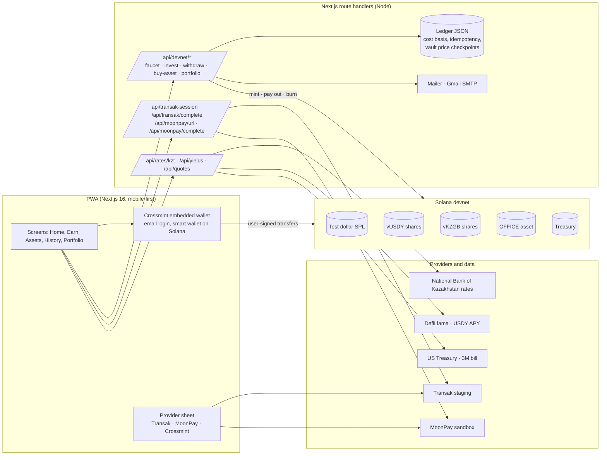
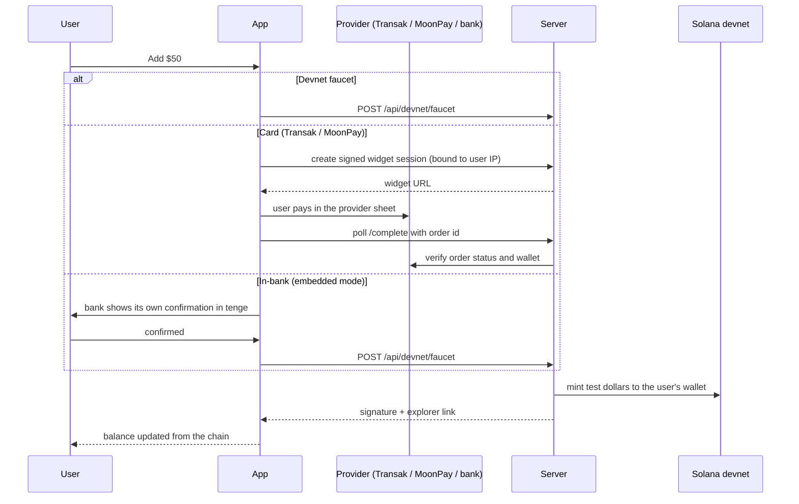
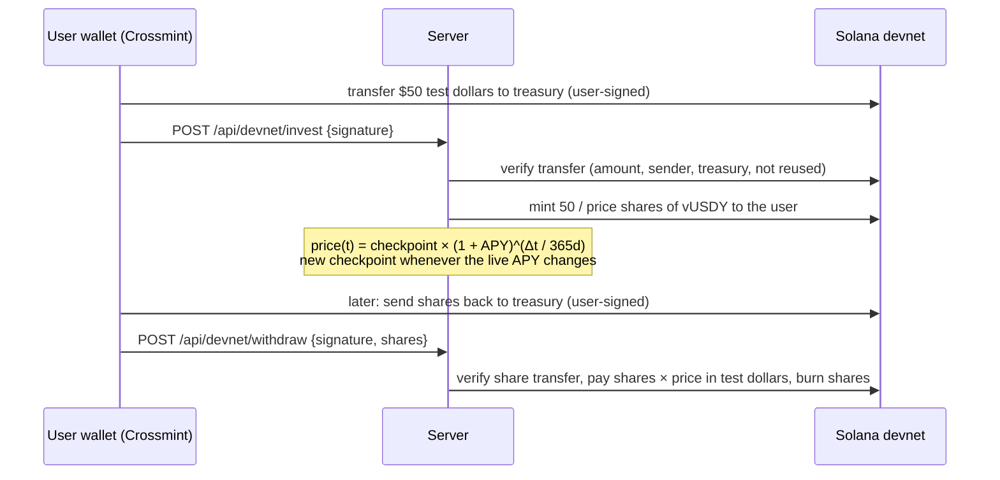

# Architecture and money flows

RWA Bridge is a seamless yield layer between everyday money and tokenized real-world assets. A user signs in with email, gets an embedded Solana wallet, adds money, and puts it into yield products or fractional asset shares. Every balance in the app is read from the user's wallet on Solana.

This build runs on **Solana devnet** with test money. Live app: https://plain.lengway.me

## Components

## On-chain objects (devnet)

| Object | Address | Role |
|---|---|---|
| Test dollar (SPL, 6 decimals) | `Hx7e212hfKYHNV5jdfV4R9NQ5JHCdt9w1g4aGYk7cSaV` | Cash balance. Stands in for USDC on devnet. |
| vUSDY (SPL share) | `NybngzX175W1p8xoL1yikAV2WnpQzHihMKgGnmifPD4` | Share of the dollar yield vault. Price follows the live USDY APY. |
| vKZGB (SPL share) | `Fn1idY7FZB4C3JaV5yZorqPUTg8sZN3ZHgqCp7mMJiAi` | Share of the local-currency government bond vault. |
| OFFICE (SPL asset) | `51UTD1qdeMmfudZdcWXgBVUoZNu4etKRDzRbkfBi9NR9` | Fractional share of a class A office building, 1 token = $1. |
| Treasury token account | `XBKEH8XpNxYdopu6Z7izwpDME2ZgX5hHrcamtVEEqmz` | Receives deposits and asset payments. |
| Treasury owner | `8Mdmu9GN72J1scQC15SAa9pvDGpNMNJhxrPbCi3nQ6iD` | Mint authority for all app tokens. |

All addresses open on https://explorer.solana.com with `?cluster=devnet`.

## Money flows

### 1. Money in

On devnet the provider delivers its own test crypto, so the server mirrors the paid amount in test dollars after it verifies the order through the provider's API. In production the provider delivers USDC on Solana directly to the user's wallet.

### 2. Earning yield (vault shares)

The position is a token in the user's wallet, so its value is visible in any explorer and survives devices and browsers. The ledger only stores cost basis, price checkpoints and used signatures.

### 3. Buying a fractional asset

The user pays test dollars to the treasury, the server verifies the payment on-chain and mints OFFICE tokens 1:1. If the mint fails after a successful payment, the client retries with the same payment signature and the server returns the existing result instead of minting twice.

### 4. Money out

- **To another wallet:** the user sends test dollars from the embedded wallet to any Solana address.
- **To a bank card:** the MoonPay sell widget opens in the provider sheet. On devnet the crypto deposit to MoonPay is simulated by moving test dollars to the treasury, and the UI labels this as a simulation.

## Live data

| Number | Source | Refresh |
|---|---|---|
| USD/KZT | National Bank of Kazakhstan RSS | 6 h |
| USDY APY | DefiLlama yields (USDY on Solana) | 6 h |
| 3-month T-bill | US Treasury daily par yield curve | 12 h |
| KZ government bond index | KASE, updated manually (no machine-readable feed) | manual |
| Provider quotes | Transak pricing API, MoonPay buy/sell quote | 30 s |

Every number is shown with its source and date and falls back to the last good value.

## Security notes

- Server secrets (Transak secret, MoonPay secret, mint authority, SMTP) never reach the browser.
- Provider widget URLs are signed server-side and bound to the user's IP (Transak `x-user-ip`, MoonPay `allowedIpAddress`).
- Every on-chain credit is verified on the server: transfer amount, sender, receiver, mint and signature reuse.
- Emails go only to addresses taken from a verified Crossmint session token, with a daily limit.

## Deployment

`scripts/deploy.sh` ships the committed HEAD to the VPS: one folder per release, shared `.env.local` and ledger, nginx with a Cloudflare origin certificate in front of `next start` on `127.0.0.1:3200`, managed by systemd.
